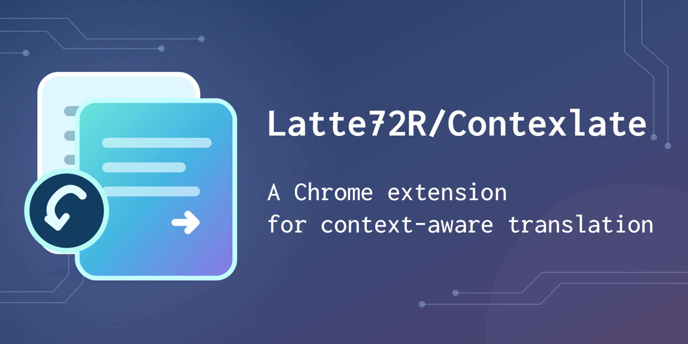

# Contexlate



PLaMo 3 Translate 向けの Chrome 拡張です。  
OpenAI 互換 API を使い、前後の文脈を参照して Web ページを翻訳します。

このリポジトリのコードは [MIT License](LICENSE) で公開しています。PLaMo 自体のライセンスについては、[公式のライセンス説明](https://huggingface.co/pfnet/plamo-3-translate-8b#license)を確認してください。

## 主な機能

- 原文の下に併記：段落や見出しごとに訳文を追加します。
- ページ全体を翻訳：元のリンクや装飾を保ちながら、本文・画像の代替テキスト・ツールチップなどを訳文に置き換えます。
- 選択文翻訳：文字を選択して右クリックし、「Contexlate で選択部分を翻訳」を押すと、別ウィンドウに訳文を表示します。

翻訳の中止、原文への復元、接続テストにも対応しています。

## 導入と設定

1. リポジトリの `extension` フォルダーを使うか、`npm run pack` で作成した `dist/contexlate.zip` を展開します。
2. Chrome で `chrome://extensions` を開き、「デベロッパー モード」を有効にします。
3. 「パッケージ化されていない拡張機能を読み込む」から、上記で作成した `manifest.json` のあるフォルダーを選びます。
4. 拡張の「設定」で下記の項目を入力し、「保存して接続テスト」を押します。
5. 翻訳したいページで拡張アイコンを押し、翻訳先と表示方法を選んで「このページを翻訳」を押します。

| 設定 | 入力例・既定値 |
| --- | --- |
| API ベース URL | `https://example.com/v1` など、利用する API の URL（初期値は空欄） |
| API キー | 利用する API のキー |
| モデル | `plamo-3-translate` |
| 並列アクセス数 | 既定は `1`、`1`〜`64` で設定可能 |

既定の翻訳先は日本語、表示方法はページ全体の翻訳です。

## 翻訳の仕組み

ページタイトルや周囲の本文を参照文脈として API に渡します。置き換えモードでは6,000 UTF-8 バイト以内に収まる div や section をまとめて翻訳し、大きすぎる場合は子のまとまりに分けます。画面内の内容を優先して訳文を反映します。

返された HTML の構造を検証し、元の要素を再利用して反映します。構造が一致しない場合や訳文が途中で切れた場合は原文を残します。429 エラーでは最大5回まで自動で再試行します。詳しくは[設計と実装比較](docs/translation-design.md)を参照してください。

## データの送信・保存と制限

翻訳対象の本文と参照文脈、または選択した文字列を設定先の API に送信します。本文に含まれる機密情報も送信対象です。API キーと訳文はブラウザー内に保存し、Chrome 同期は使いません。翻訳キャッシュは最大200件・2 MiBで、設定画面から削除できます。

入力値、パスワード、編集領域、コードブロック、非表示要素、`translate="no"` は翻訳対象外です。iframe、Shadow DOM、Canvas、画像内の文字、PDF ビューアー、Chrome 内部ページやウェブストアには対応していません。後から追加された本文は再度翻訳すると取り込みます。訳文の長さによって折り返しやレイアウトが変わることがあります。

## 開発・パッケージ作成

Node.js 22 以降と Python 3 が必要です。

```bash
npm test              # ユニットテスト
npm run pack          # 配布 ZIP の作成
npm install
npx playwright install chromium
npm run test:browser  # モック API と Chromium によるテスト
```
